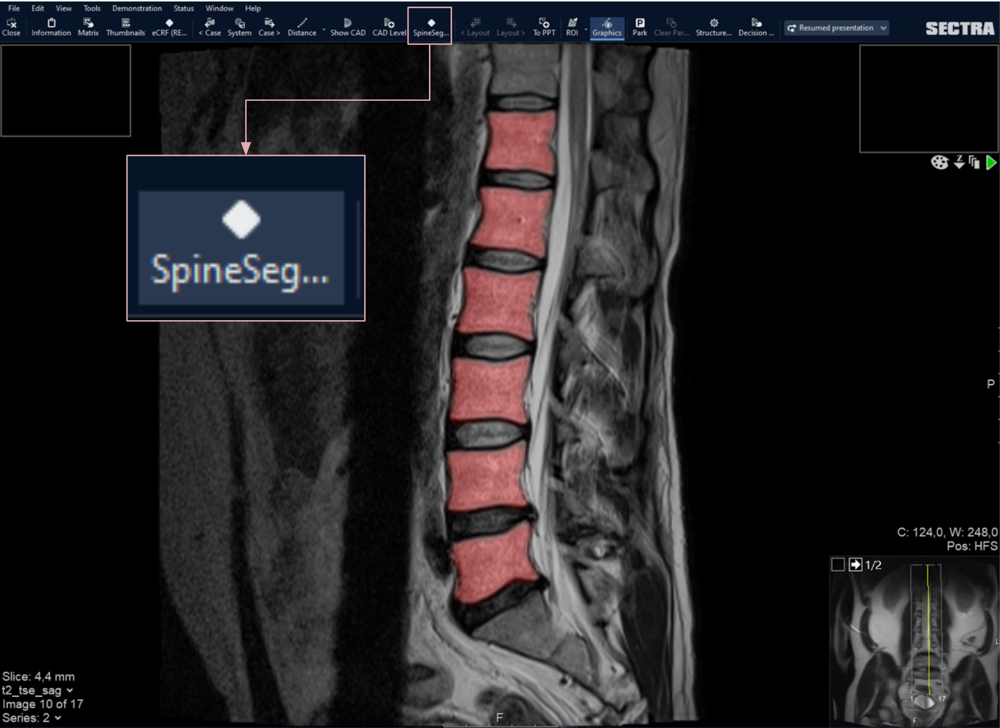

# Multi-center CNN-based spine segmentation from T2w MRI using small amounts of data

Code to reproduce our test results, train on your own data and run inference. Trained
weights and exported learners are on [Hugging Face](https://huggingface.co/skaliy/spine-segmentation).

| Notebook | Colab |
| --- | --- |
| [00-spine-segmentation-training-evaluation](https://nbviewer.org/github/MMIV-ML/fastMONAI/blob/main/research/spine/00-spine-segmentation-training-evaluation.ipynb): reproduce the test results or train your own model | [Open](https://colab.research.google.com/github/MMIV-ML/fastMONAI/blob/main/research/spine/00-spine-segmentation-training-evaluation.ipynb) |
| [01-spine-segmentation-inference](https://nbviewer.org/github/MMIV-ML/fastMONAI/blob/main/research/spine/01-spine-segmentation-inference.ipynb): run the trained model on your own data | [Open](https://colab.research.google.com/github/MMIV-ML/fastMONAI/blob/main/research/spine/01-spine-segmentation-inference.ipynb) |

## Local setup

Clone this repository and [install fastMONAI](../../README.md). Then run the notebooks, or
run inference from the command line:

```bash
python inference_script.py IMG_PATH
```

## Research PACS

The model runs in the research PACS at our hospital:


